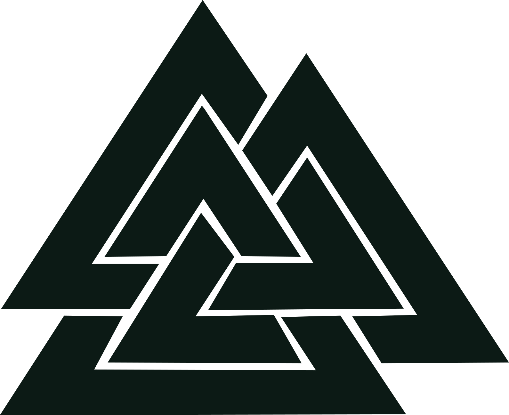
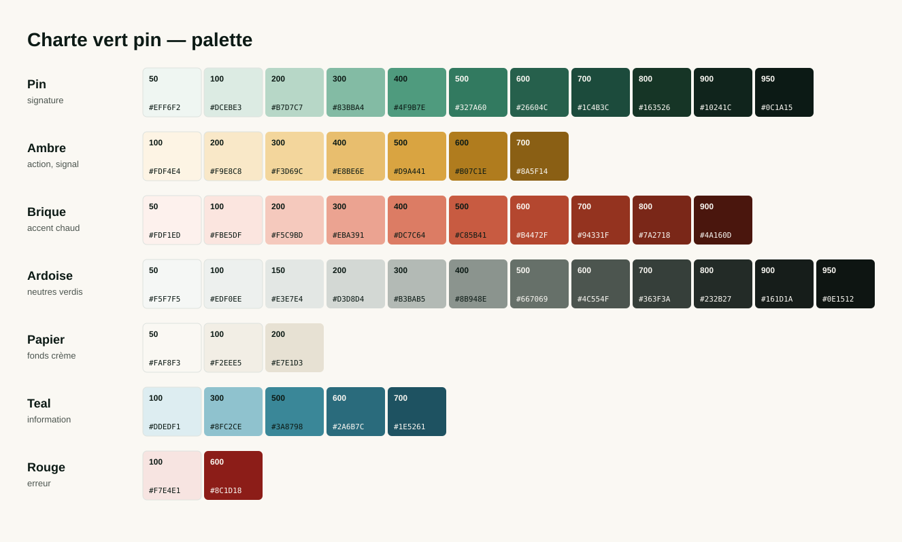

# Charte graphique vert pin — éléments graphiques

> Charte par défaut de toutes les créations depuis le 12 septembre 2026.
> Extrait le 23 octobre 2026 de la dernière version de la charte :
> - **Design System « Thomas Richard — Design System »** (la source de référence) — https://claude.ai/artifact/DF5d9TEKmGvAkRxrdmPe1y
> - **Canvas « Charte vert pin »** (état des lieux au 9 octobre + deux pistes) — https://claude.ai/artifact/HLkc2S7WrEpi1ysnyb7e7V

Fichiers fournis à côté de cette fiche, dans [`charte-graphique-vert-pin/`](charte-graphique-vert-pin/) :

| Fichier | Contenu |
| --- | --- |
| `palette.svg` | Toutes les rampes de couleur avec leurs codes hex |
| `valknut-ink.svg` | Logo valknut en pin nuit `#0C1A15`, pour fonds clairs |
| `valknut-paper.svg` | Logo valknut en papier `#FAF8F3`, pour fonds sombres |
| `valknut.svg` | Logo valknut en `currentColor` (prend la couleur du texte, pour insertion en ligne) |
| `tokens.css` | Toutes les variables CSS de la charte (polices, couleurs, typo, espacements, rayons, ombres, mouvement, mise en page) |

---

## 1. Logo — le valknut

<p>
  
</p>

- Trois triangles entrelacés : **la seule marque**. Aucun autre logo n'a été dessiné.
- Monochrome uniquement : pin nuit `#0C1A15` sur fond clair, papier `#FAF8F3` sur fond sombre.
- Jamais recoloré en dégradé, jamais déformé, jamais posé sur une photo chargée, jamais utilisé comme icône générique.
- **Filigrane** : 6 à 10 % d'opacité, en bas à droite des surfaces sombres.

**Signature (verrou de marque)** — valknut + « Thomas Richard » en Schibsted Grotesk 600, 18 px, approche −0,014 em. Sur-titre facultatif « CLUB SMART » en capitales 10 px, 600, espacé 0,09 em, opacité 70 %. Trois montages : horizontal (logo à gauche), empilé (logo au-dessus), et sur plaque pin nuit avec le valknut papier.

---

## 2. Couleurs



### Les rampes

| Rampe | Rôle | Teintes clés |
| --- | --- | --- |
| **Pin** | Couleur signature, tirée du fond du portrait. Calme, crédible. | 700 `#1C4B3C` principal · 950 `#0C1A15` éditorial / texte fort · 300 `#83BBA4` principal en sombre |
| **Ambre** | Jaune doré (couleur des yeux). Action (CTA), signal, surlignage. **Une occurrence par écran.** | 500 `#D9A441` bouton d'action, filet, focus · 200 `#F9E8C8` surlignage |
| **Brique** | Chaleur du chandail rouge. Sur-titres, séparateurs, accent de texte. | 500 `#C85B41` chaud éditorial · 600 `#B4472F` action (variante) · 700 `#94331F` texte accent, lien au survol |
| **Ardoise** | Neutres verdis, jamais de gris froid. | 800 `#232B27` texte courant · 600 `#4C554F` texte atténué · 950 `#0E1512` fond sombre |
| **Papier** | Fond crème, confort de lecture longue. | 50 `#FAF8F3` fond de page · 100 `#F2EEE5` fond en creux |
| **Teal** | Information neutre. | 700 `#1E5261` · 100 `#DDEDF1` |
| **Rouge sourd** | Erreur uniquement. | 600 `#8C1D18` · 100 `#F7E4E1` |

<details>
<summary>Tous les codes hex</summary>

| Pas | Pin | Brique | Ambre | Ardoise | Papier | Teal | Rouge |
| --- | --- | --- | --- | --- | --- | --- | --- |
| 50 | `#EFF6F2` | `#FDF1ED` | | `#F5F7F5` | `#FAF8F3` | | |
| 100 | `#DCEBE3` | `#FBE5DF` | `#FDF4E4` | `#EDF0EE` | `#F2EEE5` | `#DDEDF1` | `#F7E4E1` |
| 150 | | | | `#E3E7E4` | | | |
| 200 | `#B7D7C7` | `#F5C9BD` | `#F9E8C8` | `#D3D8D4` | `#E7E1D3` | | |
| 300 | `#83BBA4` | `#EBA391` | `#F3D69C` | `#B3BAB5` | | `#8FC2CE` | |
| 400 | `#4F9B7E` | `#DC7C64` | `#E8BE6E` | `#8B948E` | | | |
| 500 | `#327A60` | `#C85B41` | `#D9A441` | `#667069` | | `#3A8798` | |
| 600 | `#26604C` | `#B4472F` | `#B07C1E` | `#4C554F` | | `#2A6B7C` | `#8C1D18` |
| 700 | `#1C4B3C` | `#94331F` | `#8A5F14` | `#363F3A` | | `#1E5261` | |
| 800 | `#163526` | `#7A2718` | | `#232B27` | | | |
| 900 | `#10241C` | `#4A160D` | | `#161D1A` | | | |
| 950 | `#0C1A15` | | | `#0E1512` | | | |

</details>

### Les rôles (à utiliser plutôt que les rampes brutes)

| Rôle | Thème clair (défaut) | Thème sombre |
| --- | --- | --- |
| Fond de page | papier-50 `#FAF8F3` | ardoise-950 `#0E1512` |
| Carte | blanc `#FFFFFF` | ardoise-900 `#161D1A` |
| Fond en creux | papier-100 `#F2EEE5` | `#0A0F0D` |
| Fond inversé | pin-950 `#0C1A15` | papier-50 `#FAF8F3` |
| Texte fort | pin-950 `#0C1A15` | papier-50 `#FAF8F3` |
| Texte courant | ardoise-800 `#232B27` | ardoise-200 `#D3D8D4` |
| Texte atténué | ardoise-600 `#4C554F` | ardoise-400 `#8B948E` |
| Lien | pin-700 `#1C4B3C`, survol brique-700 `#94331F` | pin-300 `#83BBA4`, survol ambre-400 `#E8BE6E` |
| Bouton principal | pin-700 `#1C4B3C`, texte `#F7FBF8` | pin-300 `#83BBA4`, texte pin-950 |
| Bouton d'action (CTA) | ambre-500 `#D9A441`, texte pin-950 | ambre-400 `#E8BE6E`, texte pin-950 |
| Filets | `#DDE2DE` (fin) · ardoise-200 (défaut) | `#2B342F` · `#333C37` |
| Anneau de focus | ambre-500 `#D9A441` | ambre-500 |
| Surlignage | ambre-200 `#F9E8C8` | ambre à 22 % |

**Variantes de conversion** : `data-accent="brique"` (bouton brique-600 `#B4472F`, texte `#FFF6F2`) et `data-accent="teal"` (bouton teal-600 `#2A6B7C`).

**Surfaces éditoriales** (miniatures, cartes-titres, carrousels) : fond pin-950 `#0C1A15`, texte papier-50 `#FAF8F3`, accent et filet ambre-500 `#D9A441`, chaud brique-500 `#C85B41`.

---

## 3. Typographie

Trois familles libres, servies par Google Fonts :

| Famille | Usage | Graisses |
| --- | --- | --- |
| **Schibsted Grotesk** | Titres, interface, éditorial, miniatures | 400 à 800 |
| **Source Serif 4** | Texte long, chapeaux, citations, témoignages | 400, 500 |
| **JetBrains Mono** | Chiffres, numéros d'étapes, libellés techniques, code | 400, 500 |

```html
<link rel="stylesheet" href="https://fonts.googleapis.com/css2?family=Schibsted+Grotesk:ital,wght@0,400..900;1,400..900&family=Source+Serif+4:ital,opsz,wght@0,8..60,300..700;1,8..60,300..700&family=JetBrains+Mono:wght@400;500;700&display=swap">
```

### L'échelle, rôle par rôle

| Rôle | Taille | Graisse | Interligne | Approche |
| --- | --- | --- | --- | --- |
| Miniature YouTube | 88 px | 800 | 0,98 | −0,03 em |
| Display | 72 px | 700 | 1,04 | −0,022 em |
| H1 | 40 px | 600 | 1,14 | −0,014 em |
| H2 | 28 px | 600 | 1,14 | −0,014 em |
| H3 | 21 px | 600 | 1,14 | −0,014 em |
| H4 | 18 px | 600 | 1,14 | −0,014 em |
| Chapeau (lead) | 21 px | 400 | 1,45 | — |
| Prose (Source Serif 4) | 18 px | 400 | 1,75 | — |
| Corps | 16 px | 400 | 1,6 | — |
| Petit | 14 px | 400 | — | — |
| Légende | 13 px | 400 | — | — |
| Sur-titre (capitales) | 13 px | 600 | — | +0,09 em |
| Mono | 14 px | 400 | — | — |

Échelle complète : 12 · 13 · 14 · 16 · 18 · 21 · 24 · 28 · 33 · 40 · 48 · 58 · 72 · 88 · 104 px. Mesure de lecture : 68 caractères.

**Casse** : phrases normales partout. Capitales réservées aux sur-titres courts (« LE PARCOURS », « ATELIER · SIX PLACES »). Jamais de titre tout en capitales.

---

## 4. Formes, espacements, ombres

**Coins** — 3 px (xs) · 6 px (médias) · 8 px (boutons, champs) · 10 px (md) · 12 px (cartes) · 14 px (grandes surfaces) · 20 px (xl) · plein rond réservé aux avatars et pastilles.

**Bordures et filets** — 1 px pour les séparations, 2 px pour l'onglet actif, 3 px pour le filet d'accent d'un encadré (toujours **en haut**, jamais de bordure gauche colorée).

**Espacements** (base 4 px) — 4 · 8 · 12 · 16 · 20 · 24 · 32 · 40 · 48 · 64 · 80 · 96 · 128 · 160 px. Rythme d'une section : sur-titre, 12, titre, 12, chapeau, 32, contenu ; 80 à 96 px entre deux sections.

**Ombres** — teintées pin `rgba(16,36,28,…)`, jamais noires, courtes :

| Niveau | Valeur | Usage |
| --- | --- | --- |
| xs | `0 1px 2px rgba(16,36,28,.06)` | cartes |
| sm | `0 1px 3px rgba(16,36,28,.08), 0 1px 2px -1px rgba(16,36,28,.06)` | cartes |
| md | `0 4px 12px -2px rgba(16,36,28,.10), 0 2px 4px -2px rgba(16,36,28,.06)` | survol |
| lg | `0 12px 32px -8px rgba(16,36,28,.16)` | superpositions |
| xl | `0 28px 60px -20px rgba(16,36,28,.24)` | modales |
| focus | `0 0 0 3px rgba(217,164,65,.45)` | anneau ambre |

**Cartes** — fond blanc, filet 1 px `#DDE2DE`, coins 12 px, ombre sm ; au survol ombre md et montée de 1 px.

**Fonds** — aplats uniquement, pas de dégradé décoratif, pas de texture. Seuls dégradés permis : voiles de protection de texte sur image et fondus de miniature. Alternance : papier → creux → papier → pin nuit ; deux fonds maximum par présentation.

**Transparence et flou** — trois cas seulement : en-tête collant (88 % + flou 10 px), voile de modale (pin à 62 % + flou 3 px), synthé vidéo (pin à 86 % + flou 6 px).

---

## 5. Mise en page et formats de production

| Élément | Valeur |
| --- | --- |
| Colonne centrale | 1080 px (conteneurs 640 · 840 · 1080 · 1280 · 1440) |
| Marges de page | 20 / 32 / 48 px |
| Grille | 12 colonnes, gouttière 24 px |
| En-tête | 68 px |

| Format | Dimensions |
| --- | --- |
| Miniature YouTube | 1280 × 720 |
| Diapositive | 1920 × 1080 |
| Extrait vertical | 1080 × 1920 |
| Carrousel LinkedIn | 1080 × 1350 |
| Bannière Skool | 1584 × 528 |
| Courriel | 600 px de large |

---

## 6. Habillage vidéo et miniatures

Le décor de tournage réel : mur blanc, étagère grise chargée à gauche, lampe chaude à droite.

- **Plaque de texte** : toujours sur plaque pin nuit à 86 % (`rgba(12,26,21,.86)`, flou 6 px). Jamais d'ambre nu sur le mur blanc.
- **Synthé (nom)** : à droite, côté porte. « Thomas Richard » 32 px 600 + « Club SMART » 19 px pin-200, filet ambre de 4 px à droite.
- **Point clé** : en haut à gauche (couvre l'étagère), filet ambre de 4 px en haut, sur-titre ambre-400 en capitales.
- **Carte-titre** : voile latéral pour les chapitres (on reste visible à droite), voile plein à 82 % pour l'ouverture.
- **Miniature** : la logique jaune sur noir est gardée, mais le noir devient pin nuit `#0C1A15` et le jaune devient ambre `#D9A441`. Fondu qui mange l'étagère ou la lampe, texte jamais sur le visage, 3 à 5 mots (3 restent lisibles à 200 px de large). Étiquette en kicker : fond ambre-500, texte pin-950, capitales 12 px 700.

---

## 7. Icônes et mouvement

**Icônes** — [Lucide](https://lucide.dev), trait 2 px (`unpkg.com/lucide-static@0.460.0`). Tailles 13 · 15 · 17 · 20 · 22 px, toujours avec un texte. **Aucun emoji**, sur aucune surface. Seul caractère spécial : le point médian « · » comme séparateur.

**Mouvement** — sobre : 80 ms (pression, échelle 0,985) · 140 ms (contrôles) · 220 ms (cartes, onglets) · 380 ms (superpositions) · 620 ms (scènes vidéo). Courbe standard `cubic-bezier(.2,.6,.2,1)`, entrée `cubic-bezier(.16,1,.3,1)`. Fondus et glissements courts uniquement, aucun rebond.

---

## 8. Questions encore ouvertes (canvas du 9 octobre)

Le canvas « Charte vert pin » relève des écarts entre la charte et les créations, sans les trancher :

1. **Quatre fonds verts pour un seul rôle** — le jeton éditorial dit pin-950 `#0C1A15`, mais l'habillage utilise surtout pin-900 `#10241C` (23 occurrences), la procédure vidéo pin-800 `#163526` (20), et le carrousel un dégradé pin-600 → pin-950.
2. **Deux ou trois polices** — la procédure vidéo n'utilise pas Source Serif 4.
3. **Le teal** — rampe définie, mais aucun usage relevé dans les créations.
4. **Copies de la charte** — une source (`NEW_AIOS/1-Projets/demo-youtube-aios/design-system/`) et quatre familles de copies (skill carrousel-anime, atelier HyperFrames, site thomrichard, NEW_AIOS).
5. **Action : ambre ou brique** — le Design System met l'ambre sur le bouton d'action ; le canvas montre la brique-600 en bouton « Action ».

Deux pistes d'évolution y sont aussi explorées, où le vert devient un simple accent (≈ 92 % neutres, 6 % vert, 2 % brique) :

| | Piste A · fond noir | Piste B · fond blanc |
| --- | --- | --- |
| Fond | `#0B0D0C` | `#FFFFFF` |
| Surface | `#151917` | `#F6F7F6` |
| Ligne | `#262C29` | `#E4E7E5` |
| Texte | `#F2F0EA` | `#101412` |
| Texte doux | `#9AA39E` | `#5F6763` |
| Accent vert | `#83BBA4` | `#1C4B3C` |
| Teinte verte | `#16241E` | `#E6F0EA` (surlignage) |
| Action, rare | `#C85B41` | `#B4472F` |

Ces pistes ne remplacent pas la charte tant qu'aucune n'est retenue.
